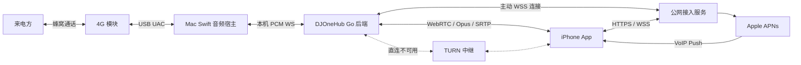
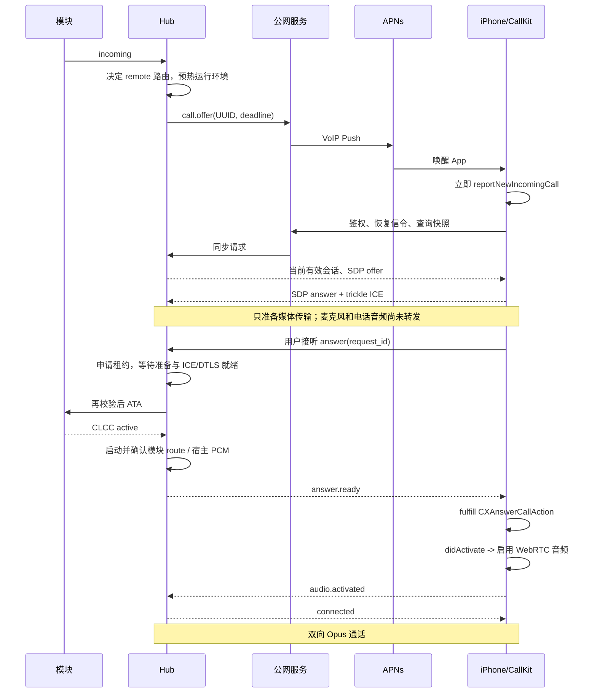

# iPhone 远程接听落地方案

日期：2026-09-30。状态：设计基线，正在分批实施；当前交付范围见 [第一批后端基础](remote-calls-first-batch.md)、[第二批通话控制](remote-calls-second-batch.md)、[第三批媒体基础](remote-calls-third-batch.md)、[第四批 WebRTC 与接收音频](remote-calls-fourth-batch.md)、[第五批会话协调与通话收尾](remote-calls-fifth-batch.md)、[第六批受认证的本机宿主控制](remote-calls-sixth-batch.md)、[第七批配对与安装身份](remote-calls-seventh-batch.md)、[第八批鉴权 WSS 与 Hub 会话适配](remote-calls-eighth-batch.md)、[第九批活动连接续期与凭据刷新](remote-calls-ninth-batch.md)、[第十批 Keychain 与原生命令](remote-calls-tenth-batch.md)、[第十一批常驻连接与来电调度](remote-calls-eleventh-batch.md) 、[第十二批 iOS 在线 App 与 TURN](remote-calls-twelfth-batch.md) 和 [第十三批后台推送与离线邀请](remote-calls-thirteenth-batch.md)。本文描述完整目标，未在实现进度中列为完成的接口、目录和参数仍为设计，不代表已经实现或通过真机验收。

## 1. 确定的产品约束

1. 使用自研原生 iOS App，通过 CallKit 展示系统来电并处理接听、拒接、挂断、静音和 DTMF。
2. AI 与远程接听是互斥的来电处理分支。模块启用 AI 接听时，不创建远程来电会话、不发 VoIP Push、不连接远程媒体，也不因 AI 失败转入远程接听。
3. 远程接听失败、无人接听、iPhone 离线时，不自动转 AI。
4. 面向互联网，音频使用 WebRTC + Opus，支持 NAT 穿透、TURN 中继、丢包恢复和网络切换。
5. 保留现有 Mac 本地接听能力，但同一通话只允许一个媒体接听方；第一版整个 Hub 同时只承载一路活动语音。
6. 第一版支持一个 Hub、多模块配置、每模块指定一个已配对 iPhone。不同模块可以指定不同 iPhone，但不支持同一来电同时呼叫多个 iPhone、呼叫等待、保持、会议和远程外呼。协议保留这些能力的扩展空间。
7. 远程通话默认不录音、不转写、不创建 AI 会话。现有 AI 通话及其录音行为继续保留。

“启用 AI”具体对应现有 `voiceAgentState.Enabled == true`。仅保存了 Provider/Profile、但已关闭 AI 开关，不视为启用。以下是唯一的路由判定顺序：

```text
AI.Enabled == true                  -> AI 分支
AI.Enabled == false && Remote.Enabled -> 远程分支
其他                                -> 本地分支
```

远程分支不可用时只保留本地接听机会和未接记录，不改变为 AI 分支。现有 Bark 通知是独立的通话结果通知，可维持原有行为；它不等于远程来电推送。

## 2. 仓库现状与必要改造

| 当前代码 | 已有能力 | 必须补齐的部分 |
| --- | --- | --- |
| `cmd/djonehub-macos/calls.go` | CLCC 轮询、ATA、ATH、拒接、DTMF | 全局 UUID、按具体通话执行命令、路由快照、串行状态机 |
| `cmd/djonehub-macos/voice_agent.go` | AI 预连接、自动接听、本机媒体 WS | AI 入口统一检查路由；远程路径不进入 Provider 逻辑 |
| `cmd/djonehub-macos/audio_host.go` | 输出人工/Agent 音频配置 | 新增独立 remote 模式和会话凭证 |
| `cmd/djonehub-macos/device_hub.go` | 按模块隔离、语音 owner | owner 从模块 ID 扩展到通话 ID、接听方和 generation；接听前占用 |
| `cmd/djonehub-macos/module_voice_darwin.go` | ADB 预热、模块音频路由 | 取消传播、超时后的过期任务隔离、资源按会话释放 |
| `macos/.../HostMain.swift` | 每 500 ms 轮询、模式切换 | 远程会话事件订阅，防止异步旧配置重启已结束媒体 |
| `macos/.../MaVoVoiceAudioService.swift` | UAC 8 kHz PCM、人工及 AI 音频 | 独立实时远程队列；关闭 Mac 本地采集/播放；准确样本时钟 |
| `cmd/djonehub-macos/usbat_darwin.go` | 同步 USB AT 命令 | 后续增加单读者的响应/URC 分发，不能另起线程争读 USB |

关键事实：当前接听接口没有指定 callID；语音 owner 在启动 route 时才获取；准备函数的超时只结束调用者等待，工作 goroutine 可能继续执行；AI 播放队列允许约 200 ms 首包缓冲及最长 300 秒积压。以上行为均不能直接继承到远程通话。

## 3. 架构与技术选型



| 部件 | 选型与责任 |
| --- | --- |
| iPhone | Swift + SwiftUI；CallKit、PushKit、AVAudioSession；原生 libwebrtc 音频栈 |
| Mac 控制与网络媒体 | 现有 Go 后端；Pion WebRTC v4；libopus C API 的薄 cgo 包装 |
| Mac USB 媒体 | 继续由 Swift UAC 宿主独占；Go 不另写 USB 音频泵 |
| 公网接入 | 独立 Go 服务 `djonehub-relay`；配对、认证、WSS 信令转发、APNs、TURN 凭证 |
| 数据存储 | 首版单实例 SQLite WAL；保存设备与授权，短时会话状态在内存；扩容后再换共享存储 |
| 中继 | coturn；UDP 优先，TCP/TLS 备用 |

Pion 负责 ICE/DTLS/SRTP/RTP/RTCP/DataChannel，不能把它当成完整的 PCM 音频引擎。Mac 侧仍须实现 Opus 编解码、RTP 播放时序、抖动缓冲、PLC/FEC 和样本时钟适配。iPhone 侧复用 libwebrtc 的音频设备和接收缓冲，不自建第二套采集引擎。[Pion 项目](https://github.com/pion/webrtc)

公网信令服务不终止 WebRTC 媒体、不解码或转码音频。媒体优先 Mac ↔ iPhone 直连，失败走 TURN。无需 SIP、SFU 或云端混音服务器。信令服务是受信任的身份与路由边界；不能仅因使用 SRTP 就宣称能够抵御信令服务被攻破后的身份替换攻击。

构建时锁定 Pion、libopus、libwebrtc、coturn 的具体版本/提交、校验和及许可证；在 P0 验证后确定版本，不依赖浮动最新版或来源不明的 iOS WebRTC 二进制。Mac 打包脚本增加 libopus 构建和链接，优先静态链接；保留 arm64/macOS 13 兼容目标。iOS 初始部署目标建议 iOS 17+，覆盖实际使用版本及当前稳定系统。

## 4. 路由与配置规则

每个模块增加独立远程配置，既不写进 AI Profile，也不要求 AI API Key：

```json
{
  "enabled": true,
  "target_installation_id": "ios-installation-uuid",
  "ring_timeout_seconds": 45,
  "caller_display": "number"
}
```

Hub 级保存 gateway 地址、Hub 身份、已配对设备；模块级保存上述配置。媒体质量参数先做内部配置，避免把码率、FEC 等细节暴露为普通用户必填项。

规则如下：

- 同时保存 AI 和远程配置是允许的；AI 开启时远程配置显示“已配置，因 AI 接听启用而暂停”。
- 通话出现时生成不可变的路由快照，含模式、配置 revision 和远程目标；后续每个 AI/远程入口都校验该快照。
- 第一版禁止在该模块振铃或通话中改变 AI enabled、远程 enabled、远程目标等路由字段，返回 `409 route_locked_by_call`；空闲后可修改。AI 内部 Profile 编辑可以保留原有能力，但不会改变当前通话所属分支。
- AI Provider 不可用仍留在 AI 分支，由原有 AI 错误/降级逻辑处理；任何 fallback 不得指向远程接听。
- 本地手动接听通过同一仲裁器申请。若本地先获得通话，则终止远程邀请，远程 iPhone 收到 `answered_elsewhere`；此后不能切回远程。
- Hub 已有活动通话时，另一模块不发送新的远程邀请；已发邀请在资源被占用时应撤销。第一版不自动挂断另一模块的新来电，让其按运营商及本地策略结束。
- 没有已配对目标、目标 token 失效、模块运行环境不可用时，不发送远程 Push；本机显示具体原因。
- iPhone 没有常驻 WS 不代表离线；后台接听正是通过 PushKit 唤醒。

AI 来电的不可违反条件：远程会话数、远程 Push 数、远程 WebRTC PeerConnection 数均为零。通用 Hub 在线心跳不属于远程来电处理。

## 5. 通话身份、状态与并发

### 5.1 身份

新增 `call_uuid`（UUID），用于 CallKit 和所有远程命令；旧 `callRecord.ID` 暂保留以兼容历史 UI/归档。映射键包含 Hub、module deviceID、call UUID、Hub boot epoch、模块 generation。不能把 CLCC index 或时间戳字符串直接当成全局稳定身份。

会话记录包括：`route_mode`、`route_revision`、`owner`、`revision`、`ring_deadline`、`answer_deadline`、`module_generation`、`media_generation`、`end_reason`。后端是通话事实的权威；公网服务只镜像和转发，不自行认定蜂窝侧已接通。

### 5.2 两层状态

蜂窝状态继续来自模块：`incoming / active / ended`，并保留已有 dialing、alerting 等本地状态。远程状态单独记录：

```text
offered -> ringing -> answering -> connected -> reconnecting -> connected
    \         \          \             \             \
     ------------------------> ended <-----------------
```

`ringing` 表示 iPhone 已报告 CallKit 来电成功，不表示用户听到了铃声；专注模式等由系统决定。`answering` 表示已获得接听租约，尚未完成蜂窝接通与音频激活。`connected` 要求蜂窝 active、模块 route 就绪、媒体传输就绪和 iOS 音频激活确认。

远程会话 `ended` 不一定等于蜂窝通话结束。例如无人接听超时只撤销远程邀请，模块可以继续振铃，保留本地接听机会。主动拒接则执行模块拒接并确认蜂窝结束。

### 5.3 单写者与租约

新增每模块 CallCoordinator，串行处理模块状态、iOS 命令、本地操作、AI 定时器、超时和资源回调。Hub 级 AudioArbiter 负责跨模块资源。

- 接听前原子申请 `{call_uuid, owner, generation}` 租约；占用窗口初始上限 12 秒。
- 不允许持有状态锁等待 HTTP、USB、ADB 或编解码。慢任务携带 context 和 generation，完成后回到 Coordinator 应用结果。
- 所有资源释放必须比较完整租约；上一通的 stop/reset 不能释放下一通的 owner。
- 协议采用至少一次传递 + 幂等执行，不宣称网络上的 exactly-once。`request_id` 去重，`expected_revision` 防过期操作，`media_generation` 防旧 SDP/ICE/音频回流。
- 去重首先于 revision 校验，同一 request ID 的重试返回原结果；终态 tombstone 和命令结果至少保留 10 分钟。
- 心跳、质量统计和纯 ICE candidate 不增加业务 revision，避免让正常接听持续遇到版本冲突；收到 stale_revision 时取新快照，仅在用户意图仍有效时以新 request ID 重试。终态后的 hangup 幂等成功，永不转向“当前其他通话”。
- 应用在发送 ATA 前再次检查 call UUID、generation、振铃状态、租约和取消标记。AT 操作已发送但结果不明时先查 CLCC，不盲目重发或切换到另一个来电。
- AT 协议本身不携带应用 UUID，不能完全消除命令发送瞬间的硬件状态竞态。通过单通话约束、URC/CLCC 校验、命令串行及拒绝模糊状态降低风险；检测到 index 复用或状态不确定时失败退出，不能猜测接听对象。

统一入口也覆盖现有网页、AI 自动接听及本地拨号，否则远程专用锁仍会被旧接口绕过。模块重启、eSIM 切换、任意 AT 调试等冲突操作在通话期间应被协调器拒绝或明确终止当前通话后执行。

## 6. 完整来电与接听时序



并行准备的结果可以任意先后到达；用户可能在 WS、SDP 或 ICE 完成前点击接听。Coordinator 记录接听意图并等待必要条件，不依赖固定消息顺序。

不能为了等待 iOS 音频首包而迟迟不 fulfill：CallKit 通常在 fulfill 后才激活音频，否则形成死锁。`answer.ready` 的条件是传输就绪、模块接通、USB 媒体就绪，而非 iPhone 麦克风已启动。随后设独立音频激活超时。[Apple 的接听处理说明](https://developer.apple.com/documentation/pushkit/responding-to-voip-notifications-from-pushkit)

超时初始值是产品策略，不是 Apple 保证：

| 环节 | 初始预算 | 到期行为 |
| --- | --- | --- |
| 远程振铃 | 最长 45 秒，受真实来电结束限制 | 结束远程邀请，保留本地振铃，不转 AI |
| 用户点击后的接通准备 | 12 秒，且小于该 CallKit action 剩余有效时间 | 未发 ATA：释放资源；已发 ATA：核实状态后终止本通 |
| fulfill 后 iOS 音频激活 | 3 秒，真机验证后调整 | 失败上报并结束已接通蜂窝电话 |
| 网络切换恢复 | 10 秒 | ICE restart 未恢复则结束本通 |
| 活动通话控制连接同时失效 | 10 秒 | WSS 和 DataChannel 均不可用时结束，避免无人能挂断 |

若 `provider(_:timedOutPerforming:)` 先到，立即取消对应操作，不再执行后到的 ATA/ready。蜂窝挂断失败时标记 `ending_pending`、继续有限重试和 CLCC 核实，保持 owner，不能显示资源已释放或把后续来电误认为原通话。

## 7. iOS App 实现

建议组件：`CallKitService`、`PushRegistryService`、`CallSessionStore`（actor）、`SignalingClient`、`WebRTCAudioClient`、`PairingService`、`CredentialStore`。

- 进程启动早期创建长期存活的 CXProvider 和 PKPushRegistry，不能等待 SwiftUI 页面出现。
- 首次使用在前台完成配对、麦克风授权、推送 token 注册及一次测试来电；麦克风未授权时不允许开启远程接听。
- 配置 Push Notifications entitlement 与所需 VoIP/音频后台能力；正确区分开发和生产 APNs 环境。上线前验证分发签名具有相应能力。
- 收到合法 VoIP Push 后立即报告 CallKit；在其 completion 中调用 PushKit completion；联网和 SDP 准备并行进行。过期来电也不能仅静默丢弃后不履行 PushKit 要求，应按平台要求报告并快速同步终态。
- 同一 UUID 的重复投递仍须完成平台要求的 CallKit 报告/PushKit completion 流程，应用会话在串行状态存储中去重；处理同 UUID 已存在的报告结果，不创建新 UUID 或第二通电话。对已结束 UUID 报告后立即应用终态。P0 必测锁定 SDK 的重复投递行为，不能把任意 Push 当成可忽略事件。
- 振铃期间预建 PeerConnection、音频 transceiver、ICE/DTLS，但通过 `RTCAudioSession.useManualAudio` 及音轨状态禁止采集和播放。
- 用户接听时开始有界的 answer 流程；处理 CXAnswerCallAction、CXEndCallAction、CXSetMutedCallAction、CXPlayDTMFCallAction 和 provider reset。
- 用户挂断立即停止本机采集/播放并记录本地终态，不让 UI 无限等待网络。经 WSS/DC 发同一幂等结束命令，重连后只补发该 UUID 的结束意图；Hub 独立执行蜂窝挂断和确认。provider reset 也必须取消待接听动作、终止媒体并尽力通知 Hub，迟到 ready 不能复活电话。
- CallKit 音频激活后通知 `RTCAudioSession.audioSessionDidActivate`，再打开 `isAudioEnabled`；失活时反向处理。使用 `playAndRecord + voiceChat` 及通话蓝牙路由，响应耳机插拔和 route change。[libwebrtc 音频会话接口](https://webrtc.googlesource.com/src/+/refs/heads/main/sdk/objc/components/audio/RTCAudioSession.h)
- 使用 SDK 既有通话语音处理做回声消除、降噪和增益；先验证默认 VoiceProcessingIO/libwebrtc 组合，不额外叠加自建 AEC/AGC。
- 静音先立即关闭本机上行，再同步 Hub；Hub 也丢弃静音状态下的上行并送静音到模块。取消静音清空旧队列。
- DTMF 走授权控制消息到已有 AT DTMF 接口，不播放混入音频的按键声。
- 首版声明不支持 holding/grouping/ungrouping，CallKit 最大一路。系统电话导致 audio deactivate 时短期暂停媒体，恢复失败则结束；不能伪装已支持蜂窝 hold。
- App 前台页面提供配对、模块别名、可接听状态、断连原因和通话记录；后台不依赖常驻 WebSocket 保活。
- Keychain 中供锁屏来电使用的凭证采用 `AfterFirstUnlockThisDeviceOnly` 等适合后台访问的策略；设备重启后首次解锁前作为明确不可保证的场景验证。
- 不注册未实现的最近通话回拨/Siri 外呼入口；首版可关闭 `includesCallsInRecents`，避免系统提供无法兑现的回拨行为。

App 被系统回收、用户强制退出、重启未解锁、专注模式等分别测试，不承诺所有状态都能响铃。PushKit 是标准唤醒路径，不能用静默音频或后台轮询代替。

## 8. Opus 与媒体处理

### 8.1 两个方向

```text
来电方 -> UAC PCM 8k/mono/s16 -> 本机 WS -> libopus 编码(8k输入)
       -> Opus RTP/SRTP -> iPhone libwebrtc -> 听筒/耳机

iPhone 麦克风 -> 系统语音处理 + libwebrtc Opus
       -> SRTP/RTP -> Mac 抖动缓冲 -> libopus 解码(8k输出)
       -> 本机 WS -> UAC -> 来电方
```

libopus 可直接使用 8 kHz 输入/输出，第一版无需人为先升采样到 48 kHz。iPhone 硬件采样率由音频系统决定。Opus RTP 时钟始终为 48 kHz：20 ms 包时间戳增加 960，即使包内来自 160 个 8 kHz 样本。SDP 的 `opus/48000/2` 是规范形式，单声道通过协商和编码设置表达，不能改成 `opus/8000/1`。[RFC 7587](https://www.rfc-editor.org/rfc/rfc7587)

### 8.2 初始媒体参数

| 参数 | 第一版默认值/边界 |
| --- | --- |
| 编解码 | Opus，语音用途，单声道，最大电话带宽 4 kHz |
| 打包 | 每包 20 ms；Mac 每次编码 160 个 PCM 样本 |
| 目标净码率 | 默认 16 kbps，按质量在 12–24 kbps 内调整 |
| VBR | constrained VBR；Mac complexity 初始 5 |
| FEC | 协商启用；依据接收反馈更新发送侧丢包预估，初值 5% |
| DTX | 先关闭作为验收基线；验证静音、时钟连续性和 VAD 后按版本开启 |
| Mac 接收抖动缓冲 | 初始 60 ms，自适应范围 40–120 ms |
| Mac 接收过期阈值 | 超过 200 ms 的语音不继续追播；重新对齐播放时钟 |
| Swift 远程 PCM 队列 | 目标 10–30 ms，硬上限 60 ms；与网络抖动缓冲分开 |
| 公网传输 | SRTP/UDP 优先；必要时 TURN TCP/TLS |

这些数值是待实测调优的起点。不能同时把网络抖动缓冲、IPC 队列和 UAC 队列都设置成 200 ms。编码器设置与 FEC 的实际生效受码率、模式和网络影响，并非开启开关就一定携带冗余。[Opus 编码控制](https://opus-codec.org/docs/opus_api-1.5/group__opus__encoderctls.html)

SDP 优先用库的 codec preference/参数 API；确需修改 SDP 时用结构化解析器及互操作测试。重点协商 `stereo=0`、`sprop-stereo=0`、`useinbandfec=1`、`maxplaybackrate=8000`、`maxaveragebitrate=24000`、20 ms ptime。这些是有方向性的能力/接收偏好；双方发送码率还须各自设置并以统计验证，不能只改一份 SDP 就假定双方行为相同。

iOS RTP sender 可用的编码参数以锁定 SDK 为准；不可用的 FEC/DTX 控制通过受支持协商完成，不依赖私有 API。接收器必须容忍合法的可变包时长，按照 Opus 包实际样本数处理，不能假定每个网络包永远是 20 ms。

### 8.3 接收、恢复与时钟

- 每个 SSRC/generation 单独维护序号展开、时间戳展开、去重和乱序队列；RTP 回绕、旧 generation 和未知 SSRC 均有明确处理。
- 按播放截止时间解码。缺一个包且后一个包带可用 FEC 时先恢复缺包，再正常解码后包；等不到则调用 Opus PLC，避免等待 TCP 式重传。
- 不默认开启音频 NACK 重传；首版靠 FEC、PLC 和缓冲，避免过期包占用带宽。若后续增加 NACK，必须限定剩余播放窗口。
- 连续严重丢包时有限 PLC 后进入舒适静音/恢复状态，不无限合成旧语音；late packets 丢弃，不在恢复后补播。
- Mac 接收解码线程唯一，避免同一 decoder 并发调用；缓冲和 FEC 的具体调用契约遵循 libopus。[Opus 解码接口](https://opus-codec.org/docs/opus_api-1.5/group__opus__decoder.html)
- UAC 与 iPhone 时钟独立。使用队列占用与样本计数做轻微速率补偿，必要时采用有状态分数重采样；不得每隔几秒整块删音频来修正正常时钟漂移。
- Mac 发送按真实样本时钟节奏出 RTP，不能在 WS 一次读出积压后瞬间发送所有包。过期输入丢弃后 RTP timestamp 按丢失的样本数跳进，禁止重新从零计时。
- 正常 ICE restart 保持逻辑通话和媒体时钟；重建 PeerConnection 时递增媒体 generation、刷新缓冲和 codec 状态，避免重复播放。
- DTX 启用后，RTP 静默不能被当作断网。连接健康依靠 ICE consent、RTCP、控制心跳和真实音频设备进度。

### 8.4 反馈与质量控制

每秒收集 RTT、丢包率、jitter、播放延迟、late drop、PLC/FEC 次数、发送码率、UAC 队列深度和路径类型。Mac 的统计须覆盖应用缓冲，不能只读 Pion 网络统计。

发送侧根据对端 RTCP RR/支持的 transport feedback 调整码率：持续拥塞时从 16 降到 12 kbps，稳定窗口后缓慢恢复，最高 24 kbps；孤立丢包时优先用 FEC，不能把所有丢包都解释为带宽不足。设置至少 5 秒调整间隔、约 20 秒恢复观察窗口。Pion 自定义编码器需要主动应用反馈，不会自动跟着浏览器式拥塞控制改变 libopus 码率。

手机 speaker、听筒、有线和蓝牙均单独验证回声与增益；网络压缩不能解决错误的音频路由或重复 AEC。

## 9. 本机 Swift ↔ Go 媒体协议

新增独立 endpoint `/api/devices/{deviceID}/calls/audio/remote/media`，仅允许本机音频宿主；不复用会创建 AI Session 的 `/agent/media`。

握手绑定 call UUID、module generation、media generation 和随机短期宿主 token；token 通过受限本机控制通道分发，用 Authorization header 传递，不放 URL/日志。该 endpoint 维持 loopback 访问边界。公网服务无法取得宿主 token。

数据格式为版本化控制 JSON + 二进制 PCM。每帧包含 sequence、sample index、frame count、generation；PCM 固定 s16le/mono/8 kHz，通常按 10 ms、80 样本封帧。校验长度、最大帧大小、方向和单调性。控制消息含 `ready/start/stop/error/health`；不使用 AI 的 `speech.started`、`audio.done` 或按句播放事件。

两方向均为有界队列，发送超时后关闭并重建会话，不能允许 WebSocket/TCP 的内核积压形成数秒音频。重连只恢复当前有效通话，不补发历史音频。Go 与 Swift 各自保留单 writer，避免控制帧与 PCM 并发写破坏消息顺序。

远程模式下 Swift 不请求 Mac 麦克风权限、不启动本地 speaker 播放；UAC 是唯一物理电话音频来源/去向。网络接收 jitter buffer 位于 Go，Swift 只做短时间设备供数及样本时钟匹配。

## 10. 公网协议与 API

### 10.1 配对与身份

首版支持自托管单用户服务，但从数据模型开始保留 tenant/user 边界。管理员在公网服务初始化受限的 Hub 登记凭证；Mac 登记后取得独立身份，不把全局管理员密钥发给手机。

Mac 本地页面生成一次性二维码：服务地址、pairing ID、至少 128 bit 随机 secret、5 分钟有效期和授权模块列表。iPhone 扫码经 HTTPS 兑换，绑定 installation ID 与设备公钥；secret 单次使用并从 UI/日志移除。之后使用可撤销设备凭证换短期 access token，私钥/刷新凭证存 Keychain，Mac 凭证存 Keychain 或权限 0600 文件。

配对不依赖 APNs token 作为身份。APNs token 只是投递地址，变化时须在认证后更新。撤销设备后，撤销远程权限并终止属于该设备的通话；保留 tombstone 防止排队旧邀请恢复。

### 10.2 公网 HTTP

| 接口 | 调用方 | 语义 |
| --- | --- | --- |
| `POST /v1/hubs/enroll` | Mac | 用受限登记凭证注册 Hub 身份 |
| `POST /v1/pairings` | Mac | 为指定模块创建限时配对邀请 |
| `POST /v1/pairings/redeem` | iOS | 单次兑换邀请并登记设备身份 |
| `POST /v1/auth/refresh` | Mac/iOS | 轮换短期 access token，检测已撤销身份 |
| `PUT /v1/installations/{id}/push-token` | iOS | 更新 token、topic、环境及注册时间 |
| `DELETE /v1/installations/{id}` | 授权 Mac/管理端 | 撤销配对及对应权限 |
| `GET /v1/calls/{uuid}` | 已授权 iOS | 查询 Hub 快照；Hub 不可达时返回带 fresh=false 的缓存/不可用状态 |
| `POST /v1/calls/{uuid}/commands` | 已授权 iOS | answer/reject/hangup/mute/dtmf；与 WS 共用命令处理器 |
| `POST /v1/calls/{uuid}/ice-credentials` | 通话两端 | 发放限时、受配额约束的 TURN 凭证 |
| `GET /v1/signal` | Mac/iOS | 升级 WSS，认证并协商协议版本 |

HTTP answer 返回 `202 accepted` 只表示命令入队，必须通过事件/查询等待 Hub 的实际结果；不能视为接通。不存在或无权访问的 call 对外不泄露其他租户信息。重试保持相同 request ID。

本机新增 `GET/PUT /api/devices/{id}/remote-calls/config`、`GET .../status` 和 Hub 配对管理接口；现有管理 UI 仍监听 loopback。

### 10.3 信令消息

```json
{
  "version": 1,
  "type": "call.answer",
  "request_id": "request-uuid",
  "hub_id": "hub-uuid",
  "device_id": "module-device-id",
  "call_uuid": "call-uuid",
  "expected_revision": 3,
  "media_generation": 1,
  "payload": {}
}
```

消息类型：`hello/resume/snapshot`、`call.offer/ringing/answer/answer.ready/connected/end/ended`、`call.mute/dtmf`、`rtc.offer/answer/ice/restart`、`audio.activated`、`command.result`、`ping/pong`。服务端推导 actor 身份，不相信 payload 里的 user/owner 声明。

每通话事件含递增 revision、event ID 和服务端时间；命令含绝对有效期，并在 Hub 使用单调时钟执行预算。WS 重连通过 last event ID 补齐，超出短期保留窗口直接发权威 snapshot；有缺口时暂停依赖旧状态的操作。

短期 access token 初始有效期 15 分钟，提前刷新；已建立 WS 不能永久绕过到期/撤销检查，使用受支持的重新鉴权或有序重连。活跃通话的 WSS 换 token 不能重建 CallKit UUID 或强制重建媒体；撤销事件则立即生效。APNs、应用身份、宿主媒体与 TURN 凭证各自独立轮换。

由 Hub 固定担任 SDP offerer；iOS 网络变化发送 restart 请求，由 Hub 合并并生成新 offer，避免协商冲突。ICE candidate 按 SDP generation 缓存并限量；匹配 remote description 后才应用。

PeerConnection 内建立可靠有序的 `call-control` DataChannel，承载已授权会话的心跳、挂断、终态和状态核对，作为 WSS 短时中断的备用通道。所有命令进入同一幂等处理器；它不能建立新权限或创建下一通电话。媒体始终走 RTP，不走 DataChannel。

错误码至少包括：`ai_route_selected`、`route_locked_by_call`、`call_ended`、`stale_revision`、`stale_generation`、`not_ringing`、`audio_busy`、`device_detached`、`host_unready`、`media_timeout`、`answer_timeout`、`hub_offline`、`permission_revoked`、`protocol_unsupported`。

## 11. APNs 投递与后台可靠性

公网服务使用专用 APNs signing key，通过 HTTP/2 发起推送；密钥不进入 Mac 发行包或 iOS App。使用 `apns-push-type: voip`、`apns-topic: <bundle-id>.voip`、高优先级，`apns-expiration: 0`。请求 ID 关联 call UUID，便于排查；APNs 成功响应只表示接受，不表示手机已响铃。[Apple APNs 请求文档](https://developer.apple.com/documentation/usernotifications/sending-notification-requests-to-apns)

```json
{
  "aps": {},
  "version": 1,
  "call_uuid": "uuid",
  "hub_id": "uuid",
  "device_id": "module-id",
  "module_name": "工作号码",
  "caller_display": "+8613800000000",
  "expires_at": "2026-09-30T12:00:45Z"
}
```

Payload 只含显示与关联信息，不含登录凭证、媒体 token、SDP、TURN 密码或 AI 配置。caller display 支持用户选择只显示模块名称；号码本身不要写入普通服务日志。

- Hub 发布 offer 和结束事件进入有序 outbox；公网每次投递前检查最新远程路由、有效期及 Hub offer 存活租约。
- 正常每个 call/installation 只提交一次来电 Push。网络超时导致 APNs 是否接受不明时，先确认会话仍有效，再做有限重试；同一 UUID 去重，接受可能出现极短暂的过期 UI，不能承诺撤回已在途推送。
- 前台已有连接时可直接发来电事件并等待即时确认，短期限内未确认再发 Push；两条路径使用同一 UUID。不要因为旧连接还在就漏发后台来电。
- token 失效按 APNs 返回及注册时间条件作废，避免旧失败响应误删刚更新的 token；配置/鉴权错误不无限重试，服务限流按退避处理且不超过来电有效期。
- 挂断、接听成功、取消和状态更新走信令连接，不能发送“取消型 VoIP Push”或把 VoIP Push 用于保活。[Apple PushKit 行为要求](https://developer.apple.com/documentation/pushkit/pkpushtype/voip)
- iPhone 收到延迟通知后同步终态并结束 UI；本地设置邀请截止计时，信令不可达也不能一直响铃。Push 完成后有通信连接时及时订阅取消事件。
- 公网服务重启丢失活动镜像后先与 Hub reconcile，不从历史数据库重放来电 Push；只有当前 Hub epoch 的新鲜状态可以恢复邀请。

## 12. 互联网部署

推荐最小部署是一个靠近主要用户的公网 Linux 主机，运行接入服务、TLS 入口和 coturn；明确划分持久数据与密钥。Mac 与 iPhone 均主动连出，不要求家庭路由器映射端口，不公开现有 `7575`。

| 地址/端口 | 用途 |
| --- | --- |
| `signal.example.com:443/TCP` | HTTPS/WSS；反向代理支持长连接 |
| `turn.example.com:3478/UDP` | STUN/TURN 首选 |
| `turn.example.com:3478/TCP`、`5349/TCP` | TURN TCP/TLS 备用 |
| TURN 专用公网 IP 的 `443/TCP` | 严格网络下的 TURN/TLS；不能假设普通 HTTP 反向代理会转发 TURN |
| 配置的 UDP relay 端口段，例如 `49160–49259` | TURN 中继分配；防火墙与容器/NAT 映射一致 |

若要求 HTTPS 与 TURN/TLS 都使用 443，首版优先分配第二公网 IP；同一个 IP/端口复用需额外 L4 路由设计，不能仅换域名就同时监听。没有第二 IP 时先用 5349，并把受限网络兼容性列为已知部署差异。

ICE gathering 同时收集直连和中继候选，避免等直连完全超时才申请 TURN。一般优先 UDP，允许 TURN/TLS 作为最后可达路径；TCP 仍可能有队头阻塞，不能承诺和 UDP 相同延迟。[WebRTC TURN 说明](https://webrtc.org/getting-started/turn-server)

TURN 使用限时凭证、认证、用户带宽和 allocation 配额；关闭匿名中继，限制不应访问的内网/环回地址。coturn 共享密钥只放服务端。初始凭证有效期 2 小时，长通话到期前申请新凭证并预建新 allocation/ICE restart，保留旧通路直到新通路成功；必须验证超过凭证有效期的通话。[coturn 项目](https://github.com/coturn/coturn)

Mac WSS 空闲心跳约 20 秒、带抖动重连退避 1–30 秒；来电/通话期间采用约 2 秒控制心跳。iOS 只在前台或通话生命周期维持连接。TLS 证书续期、APNs key、数据库和配对凭证需要备份/轮换策略。

## 13. 异常与恢复策略

| 场景 | 确定行为 |
| --- | --- |
| AI 已启用 | 仅 AI 分支，远程零邀请、零媒体；AI 故障仍不转远程 |
| 来电方在 Push 到达前挂断 | Hub 记终态；手机报告后同步并快速结束；不执行 ATA |
| 手机拒接 | 对该 UUID 执行拒接；确认结束；不可误挂下一通 |
| 无人接听/推送未到达 | 到期关闭远程邀请，本机保留未接记录，不转 AI |
| 本地先接听 | 原子抢占成功后关闭远程邀请；手机显示已在其他设备接听 |
| ICE 建立失败且未发 ATA | fail CallKit action，释放资源，保留本地振铃 |
| ATA 已成功但媒体失败 | 挂断本通，清理资源，报告失败，不留接通后的无声计费通话 |
| Wi-Fi/蜂窝切换 | 保持 UUID；ICE restart；清旧音频队列，最多恢复 10 秒 |
| WSS 断开但媒体/DC 正常 | 继续通话，DC 保持控制并后台恢复 WSS |
| WSS 和 DC 均失效 | 10 秒内不能恢复则两端结束；Hub 尝试挂断蜂窝通话 |
| 只有 RTP 静默 | 结合 DTX、RTCP、consent 与 UAC 健康判断，不能直接判掉线 |
| Swift 宿主崩溃/UAC 卡住 | 有界尝试恢复；失败终止已接通本通，远程不回退 Mac speaker |
| 模块拔出/重枚举 | 递增 generation、结束原通、释放原租约；旧回调全部作废 |
| Mac 休眠/网络中断 | 服务标记不可用；客户端结束。启用远程时明确要求 Mac 持续在线，可用显式防闲置睡眠选项 |
| Mac 后端重启 | epoch 更新、旧 token/SDP 失效，扫描 CLCC 与最小会话日志核对；不自动接听或重新推送旧通话 |
| 重启后存在无法确认归属的 active | 标记待本机处理，保留资源隔离，不猜测 ATH 或挂到新的电话 |
| 设备权限撤销 | 停止对应邀请和媒体；挂断确认属于该会话的活动通话 |
| 系统音频打断 | 暂停采集，有限恢复；不宣称支持 call hold；超时明确结束 |

接通/结束的关键日志写入本机最小 journal，帮助崩溃恢复。恢复操作必须校验通话身份和模块状态；底层不能提供足够证据时优先要求本机处理，避免误操作新通话。

## 14. 来电检测与后台任务优化

第一阶段使用自适应 CLCC 轮询：远程已启用且模块空闲时目标 1 秒；已检测振铃/接通变化时短期 250–500 ms；稳定通话约 1 秒；其他模块保持原有节奏。先测 USB/AT 负载和短信/eSIM 影响，再确定参数。

长期由单读者 AT broker 分发 URC 和命令响应，收到 RING/CLIP/NO CARRIER 等事件后立即查询 CLCC，并保留轮询兜底。当前 `drainLocked()` 丢弃输入，不能直接加一个独立 USB reader。该重构单独交付，覆盖现有短信与 eSIM 的交互式 AT 流程；不把未经验证的 URC 支持作为首版可用的前置假设。

通话控制比后台健康轮询优先；不可中断的长 eSIM/设备配置操作开始前将远程状态标为暂不可用，避免手机响铃后才等待几十秒。模块运行时下载、权限申请、首次初始化均放在开启远程功能前，来电期间只复用已安装运行时并做轻量预热。

ADB 准备函数改为接收 context；对无法中断的底层步骤设置单步超时，迟到结果只能做属于旧 generation 的清理，不能启动 route 或发送 ATA。保留原语音实现“CLCC active 后才启动真实模块音频路由”的约束。

## 15. 安全、隐私与运维边界

- 公网只暴露远程通话协议；不代理任意本机 URL、任意 AT、eSIM 或短信管理接口。
- 模块、通话、媒体和 TURN 权限按 tenant/Hub/installation 校验，拒绝客户端伪造其他设备身份；请求体、SDP、ICE candidate、DTMF 和频率均有边界。
- SRTP 密钥在两端协商，TURN 仅转发密文。云端信令可见配对信息、来电显示和 SDP/网络元数据；向用户准确披露，不宣称云端完全不可见。
- 默认不保存音频或完整 SDP；日志隐藏电话号码、APNs token、Authorization 和候选 IP；关联使用 call UUID。
- WS 与 HTTP 使用 TLS；WSS token 放认证头，避免 query 泄漏；轮换和撤销 refresh credential，服务端记录设备授权审计。
- 健康检查区分 Hub 在线、模块可用、运行时已预备、宿主健康、推送可用和 TURN 可用，不能只显示一个“已连接”。
- 自用部署也需要具备推送能力的签名配置。目标 iPhone/分发区域的 CallKit 可用性在 P0 真机验证；如考虑商店发布另行确认当前审核要求。本方案按用户选择使用 CallKit，不改为其他通信框架。

## 16. 质量目标、流量与观测

以下是工程验收目标，须以明确网络条件测量，不是当前性能或公网保证。

| 指标 | 正常网络目标 |
| --- | --- |
| 从模块实际来电到 Hub 识别 | 自适应轮询通常约 1 秒量级，记录最坏等待；URC 优化另测 |
| 从 Hub 识别到 iPhone CallKit 报告成功 | p95 ≤ 3 秒，单列 APNs 延迟/未达率 |
| 用户点击接听到双向可听 | 已预热场景 p95 ≤ 3 秒；超时受接听预算限制 |
| 桥接附加单向延迟 | 网络 RTT ≤ 100 ms、丢包 ≤ 1% 时目标 100–220 ms；不含运营商原有时延 |
| 网络切换 | 可恢复网络条件下目标 ≤ 5 秒，10 秒失败截止 |
| 长通话 | 连续 3 小时无持续积压、明显时钟漂移、内存增长或凭证到期中断 |
| 资源收尾 | 终态后 3 秒内完成普通资源清理；挂断不确定单列 pending 状态 |

Opus 16 kbps 为净音频码率，不含包头。按 20 ms 打包，加上 RTP/SRTP/UDP/IP、RTCP 和可能的 TURN 开销，容量规划先按每方向 40–80 kbps，即终端双向约 36–72 MB/小时；这是估算范围，DTX、IPv6、TLS 和路径会改变实际值。TURN 出口、入口及服务商计费口径分开记录。

事件时间线至少记录：`modem_detected`、`route_selected`、`push_submitted`、`ios_reported`、`answer_pressed`、`lease_granted`、`ice_connected`、`ata_sent`、`clcc_active`、`host_ready`、`audio_activated`、`first_media_each_direction`、`ended`。跨设备绝对时钟不可直接视为准确延迟，配合 RTT/时钟偏移或测试端声学标记测量。

## 17. 目录与实施拆分

```text
cmd/djonehub-relay/                 公网服务入口
internal/callcontrol/               路由、状态机、租约、幂等命令
internal/remotecall/                Hub 信令客户端、会话适配
internal/rtcmedia/                  Pion、Opus、RTP 时序、缓冲、统计
internal/opuscodec/                 libopus 薄封装与生命周期管理
internal/relay/                     配对、鉴权、WS 路由、APNs、TURN 凭证
ios/DJOneHubPhone/                  原生 iOS 工程及测试
macos/.../RemoteMediaClient.swift   独立实时 PCM 客户端
deploy/remote-call/                 部署示例、端口说明、证书和密钥配置模板
```

现有 `voiceagent` Provider 注册表不加入 remote provider；保持“AI Provider”和“接听方”是两个不同概念。通用音频宿主可共用 USB 底层，但 AI 长回复队列和远程实时队列独立。

| 阶段 | 交付物与验收门槛 | 估算人日 |
| --- | --- | --- |
| P0：关键路径验证 | 签名/VoIP Push/锁屏 CallKit；iOS ↔ Pion/libopus 互通；核对真实模块音频；固定依赖版本 | 3–5 |
| P1：通话控制 | 路由互斥、UUID、Coordinator、接听前租约、幂等/取消、旧入口接入 | 4–6 |
| P2：远程媒体 | Swift remote 模式、本机协议、Opus 双工、短队列、FEC/PLC/时钟与统计 | 5–8 |
| P3：公网与 App 集成 | 配对、凭证、APNs、TURN、CallKit 动作、音频路由、断连恢复、管理页 | 5–8 |
| P4：稳定性与发布 | 弱网/系统打断/长通话/多模块、部署、打包、许可证及运维手册 | 4–7 |

合计约 21–34 人日，单人连续投入约 4–7 周；前提是模块本地语音已有稳定真机结果、签名和公网资源就绪，不含商店审核等待。URC broker 的全面重构作为后续独立优化，避免让首版同时承担 USB AT 全链路重写风险。

P0 可以使用仅用于验证的音频源，但 P2/P3 完成标准必须是实际模块电话；不能用 WebRTC loopback 通过代替真实来电验收。

## 18. 验证矩阵与发布条件

### 自动化

- 路由表覆盖 AI/Remote 所有开关组合；AI 启用及 Provider 失败时断言远程调用次数为零。
- 用可控时钟验证远程超时不会触发 AI；配置修改与来电进入的原子性。
- 模拟重复、乱序、断线重放、旧 revision、旧 generation、相同 CLCC index 复用；保证旧命令不作用到新通话。
- 本地/AI/远程同时接听、两模块同时来电、资源租约到期、迟到准备回调、挂断失败和后端重启。
- Opus/RTP 验证采样数和 48 kHz timestamp、序号回绕、不同合法包时长、FEC/PLC、DTX 静默、乱序/late drop；用已知音频和参考解码器验证，而非仅镜像实现逻辑。
- 媒体长时间加速仿真队列有界与时钟偏差；权限与协议测试覆盖跨模块越权、已撤销设备、过期配对、token 更新竞态和载荷边界。
- Go 执行受影响包测试及竞态检查，Swift/iOS 执行状态机与生命周期测试，再跑仓库现有回归。

### 真机与网络

| 类别 | 必测项 |
| --- | --- |
| iOS 生命周期 | 前台、锁屏、后台挂起、系统回收、强制退出、重启未解锁及解锁后、麦克风拒绝/撤回、专注模式 |
| 音频设备 | 听筒、外放、有线、AirPods/蓝牙、通话中切换、系统电话打断 |
| 网络 | 家庭 Wi-Fi、蜂窝 CGNAT、IPv6/NAT64、强制 TURN/UDP、UDP 禁用的 TURN/TLS、网络切换 |
| 弱网 | RTT 50/150/300 ms，抖动 20/50/100 ms，随机丢包 1/3/5/10%，突发丢包、限速和完全断网 |
| 通话竞态 | 一声挂断、秒接、拒接/挂断重试、推送延迟、重复 Push、本地抢接、AI 开启、同时来电 |
| 稳定性 | 每条核心路径至少 100 次呼入、3 小时长通话、24 小时待机/间歇呼入、TURN 凭证轮换 |
| 故障恢复 | Swift 崩溃、Go 重启、公网服务重启、模块拔出、USB 重枚举、Mac 休眠、撤销配对 |

发布阻断条件：AI 来电触发了远程通知；任何跨通话/跨模块误接或误挂；默认泄漏 Mac 麦克风/扬声器音频；接听失败后留下无人控制的接通通话；长通话缓冲持续增长；UDP 受限时未按部署承诺建立 TURN/TLS；凭证过期导致长通话静默中断。

完成时交付 Mac 发行包、iOS 安装/签名说明、公网部署包、API/协议定义、实测报告和故障定位手册。所有硬件或系统限制在报告中记录实际结果，不用“理论支持”替代验收。
